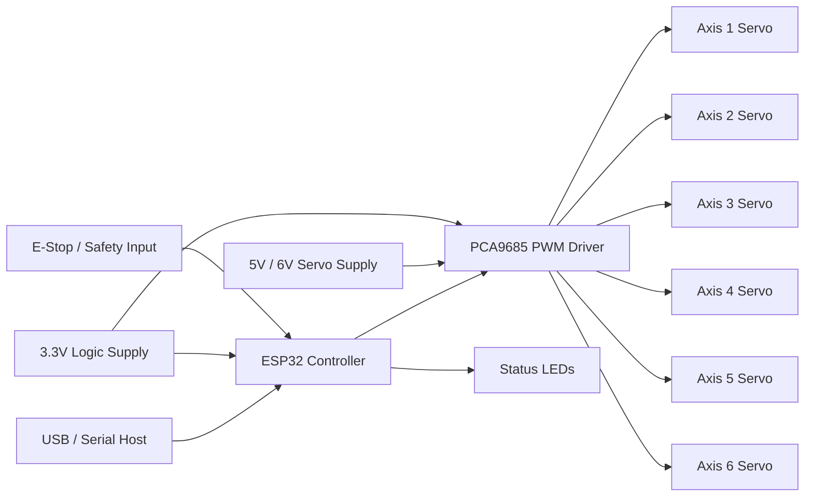
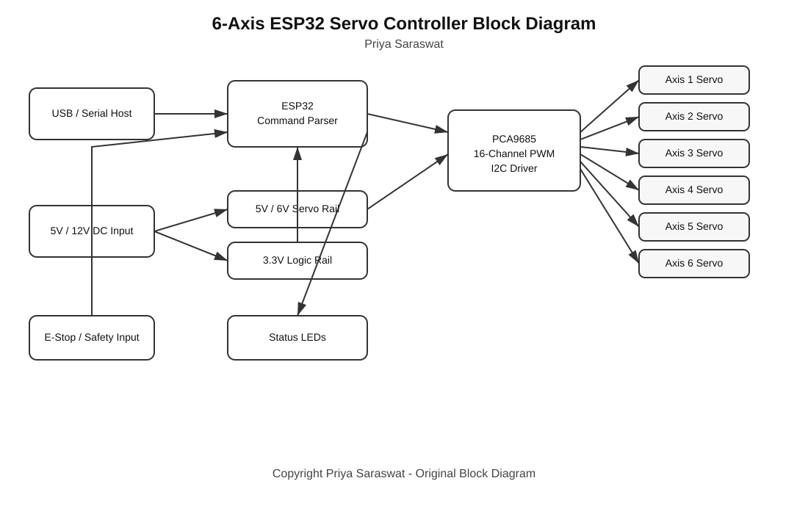
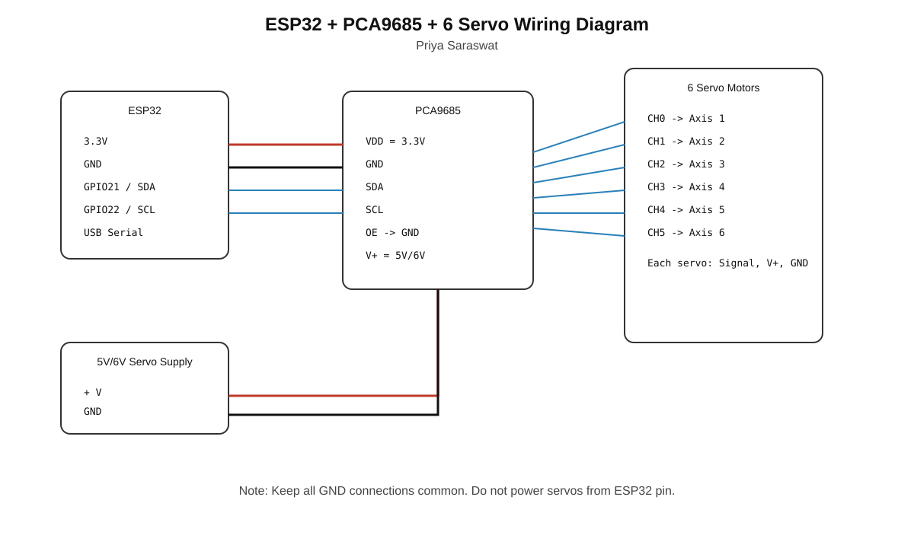
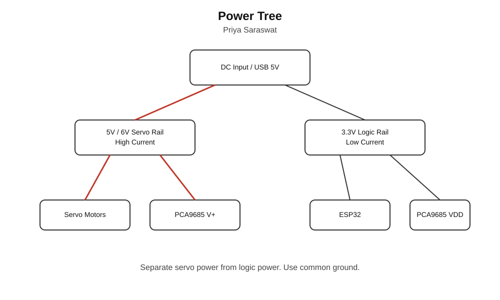

# 6-Axis ESP32 Servo Robot Controller


**Author:** Priya Saraswat  
**GitHub:** https://github.com/learnwithpriya  
**Project Type:** Embedded Systems / Robotics / PCB Design

This project is an original 6-axis robot controller design using ESP32 and PCA9685 PWM driver. It controls six servo motors for a robotic arm prototype.

---

## Features

- ESP32-based controller
- PCA9685 16-channel PWM servo driver
- Six servo motor output channels
- USB serial command interface
- Adjustable servo pulse width range
- Status reporting through serial monitor
- Modular PCB-friendly architecture
- Suitable for educational robotics and freelance prototype work

---

## Block Diagram



---

## Images

### Block Diagram SVG



### Wiring Diagram SVG



### Power Tree SVG



---

## Hardware Used

| Component | Quantity | Purpose |
|---|---:|---|
| ESP32 Dev Module | 1 | Main controller |
| PCA9685 PWM Driver | 1 | Servo signal generation |
| Servo Motor | 6 | Axis 1 to Axis 6 |
| 5V/6V Power Supply | 1 | Servo power |
| 3.3V Regulator | 1 | Logic power |
| 4.7k Resistors | 2 | I2C pull-ups |
| 100nF Capacitors | Multiple | Decoupling |
| 470uF Capacitor | 1 | Servo rail filtering |
| Servo Connectors | 6 | Motor output |
| DC Power Jack | 1 | Power input |
| Status LED | 1 | Debug indication |

---

## Firmware

Firmware file:

```text
firmware/esp32_6axis_servo_controller/esp32_6axis_servo_controller.ino
```

Required Arduino libraries:

1. ESP32 Board Package
2. Adafruit PWM Servo Driver Library

Board settings:

```text
Board: ESP32 Dev Module
Baud Rate: 115200
```

---

## Serial Commands

Open Serial Monitor at:

```text
115200 baud
```

Commands:

```text
PING
HELP
STATUS
CENTER
ZERO
STOP
MOVE <axis> <angle>
SET <a1> <a2> <a3> <a4> <a5> <a6>
```

Examples:

```text
PING
```

Response:

```text
PONG
```

Move Axis 1 to 90 degrees:

```text
MOVE 1 90
```

Set all axes:

```text
SET 0 45 90 135 90 45
```

Center all axes:

```text
CENTER
```

Safe stop:

```text
STOP
```

---

## Important Power Warning

Do not power six servo motors directly from the ESP32 USB port or ESP32 5V pin.

Use:

- Separate 5V/6V servo supply
- Common ground between ESP32, PCA9685, and servo supply
- Bulk capacitor on servo power rail
- Fuse or current limiting for demo/freelance use

---

## Folder Structure

```text
/docs       Documentation and diagrams
/firmware   ESP32 firmware source code
/hardware   BOM and PCB checklist
README.md   Project overview
REPORT.md   Full project report
```

---

## Attribution

This project was developed as an original ESP32 + PCA9685 servo controller design. Public robotics controller examples were used only as general background reference. The architecture, documentation, firmware structure, and PCB design checklist in this repository are my own work unless otherwise credited.

**Designed and documented by Priya Saraswat.**
